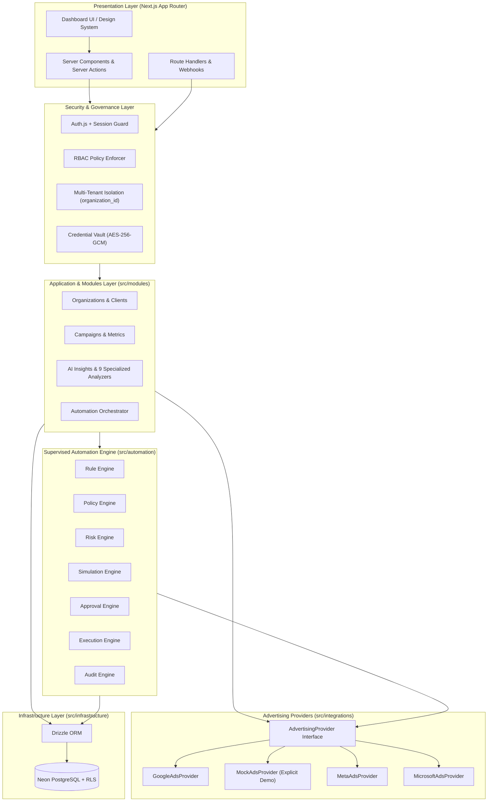

# Arquitetura do Sistema — Konnexy Ads

## 1. Visão Arquitetural

O **Konnexy Ads** utiliza uma arquitetura de **Monólito Modular** fundamentada em **Clean Architecture**, **Domain-Driven Design (DDD)** tático e princípios **SOLID**. Essa escolha garante:
- **Baixa complexidade operacional** de deploy (single deployable unit na Vercel + Neon PostgreSQL serverless).
- **Fronteiras de domínio rígidas**, permitindo extrair módulos críticos (como o Motor de Execução ou Sincronização de Anúncios) para workers dedicados no futuro sem reescrita de regras de negócio.
- **Tipagem ponta a ponta** com TypeScript Strict e validação em tempo de execução com `Zod`.

---

## 2. Separação de Camadas

1. **Presentation (`src/app`, `src/components`)**:
   - Páginas Next.js App Router, layouts responsivos, sidebar recolhível, command palette, gráficos Recharts e tabelas TanStack Table.
   - Não contém regras de negócio nem acesso direto ao banco de dados.
2. **Application & Modules (`src/application`, `src/modules`)**:
   - Casos de uso orquestrados por módulo vertical (`organizations`, `campaigns`, `ai`, `automation`, `audit`).
3. **Domain (`src/domain`)**:
   - Entidades puras, Value Objects (ex.: `Money`, `DateWindow`), enums de domínio e invariantes de negócio independentes de framework.
4. **Integrations (`src/integrations`)**:
   - Porta `AdvertisingProvider` e adaptadores desacoplados (`GoogleAdsProvider`, `MockAdsProvider`, `MetaAdsProvider`, `MicrosoftAdsProvider`).
   - Inclui tratamento de rate limit, retry exponencial com jitter, timeout, paginação e normalização de erros.
5. **Security (`src/security`)**:
   - Controle de acesso baseado em papéis (`RBAC`), validação de isolamento multi-tenant (`assertTenantAccess`), criptografia de credenciais (`AES-256-GCM`), prevenção contra SSRF, rate limiting, sanitização de logs e bloqueio de categorias restritas.
6. **Automation (`src/automation`)**:
   - Implementa os 7 motores (`Rule`, `Policy`, `Risk`, `Approval`, `Simulation`, `Execution`, `Audit`) seguindo o pipeline obrigatório de 9 etapas, além de circuit breaker, idempotência, cooldown e Kill Switch.
7. **Workflows (`src/workflows`)**:
   - Definições de fluxos agendados (Vercel Cron) e fluxos duráveis (Vercel Workflow SDK pattern) para sincronização periódica e verificação pós-execução.
8. **Infrastructure (`src/infrastructure`)**:
   - Cliente Neon PostgreSQL, schemas Drizzle ORM dos 22 domínios e migrations SQL versionadas.
