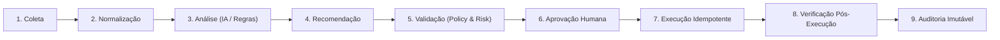

# Motor de Automações Supervisionadas — Konnexy Ads

## 1. Arquitetura dos 7 Motores

O subsistema `src/automation` é composto por 7 motores independentes e testáveis:

1. **Rule Engine**: Avalia condições compostas (`AND` / `OR`) sobre métricas normalizadas (ex.: `CPA > R$ 45,00 AND Gasto >= R$ 150,00 AND Conversões == 0`), respeitando janela temporal (`timeWindowDays`) e volume mínimo de dados (`minImpressions`, `minClicks`, `minSpend`).
2. **Policy Engine**: Verifica se a campanha ou alteração proposta viola políticas de segurança, limites financeiros máximos da organização (`maxDailyBudgetChangePct`), horário permitido ou restrições de produtos proibidos.
3. **Risk Engine**: Classifica cada ação proposta em `LOW`, `MEDIUM`, `HIGH` ou `CRITICAL` com base no impacto financeiro percentual, histórico da campanha e reversibilidade.
4. **Approval Engine**: Determina se a ação exige aprovação humana explícita. No modo padrão (`READ_ONLY`) ou Supervisionado (`SUPERVISED`), **100% das mutações reais exigem aprovação explícita** de um usuário com papel `OWNER`, `ADMIN` ou `TRAFFIC_MANAGER`.
5. **Simulation Engine**: Calcula uma prévia do efeito esperado antes da execução (ex.: impacto no orçamento mensal e redução projetada de desperdício).
6. **Execution Engine**: Executa a ação aprovada garantindo:
   - Verificação do **Botão de Emergência (Kill Switch)**.
   - Verificação do **Modo de Operação** (bloqueia imediatamente se `READ_ONLY`).
   - Verificação de **Cooldown** (impede alterações repetidas na mesma campanha dentro da janela mínima, ex.: 6 horas).
   - Verificação de **Idempotência** (`idempotencyKey` único; bloqueia execuções duplicadas).
   - **Circuit Breaker**: Abre o circuito automaticamente após falhas consecutivas na API do provedor.
7. **Audit Engine**: Registra cada transição de estado com timestamp, usuário/sistema responsável, estado anterior, estado proposto e resultado da verificação.

---

## 2. Fluxo Obrigatório de 9 Etapas

---

## 3. Botão de Emergência (Emergency Kill Switch)

- Disponível permanentemente no topo da aplicação.
- Quando acionado:
  1. Altera o estado da organização para `emergencyStopActive = true`.
  2. Força o modo de operação para `READ_ONLY`.
  3. Cancela imediatamente todos os `execution_jobs` pendentes.
  4. Bloqueia qualquer chamada ao `ExecutionEngine.execute()` até que um `OWNER` ou `ADMIN` restaure manualmente a operação e registre justificativa no log de auditoria.
