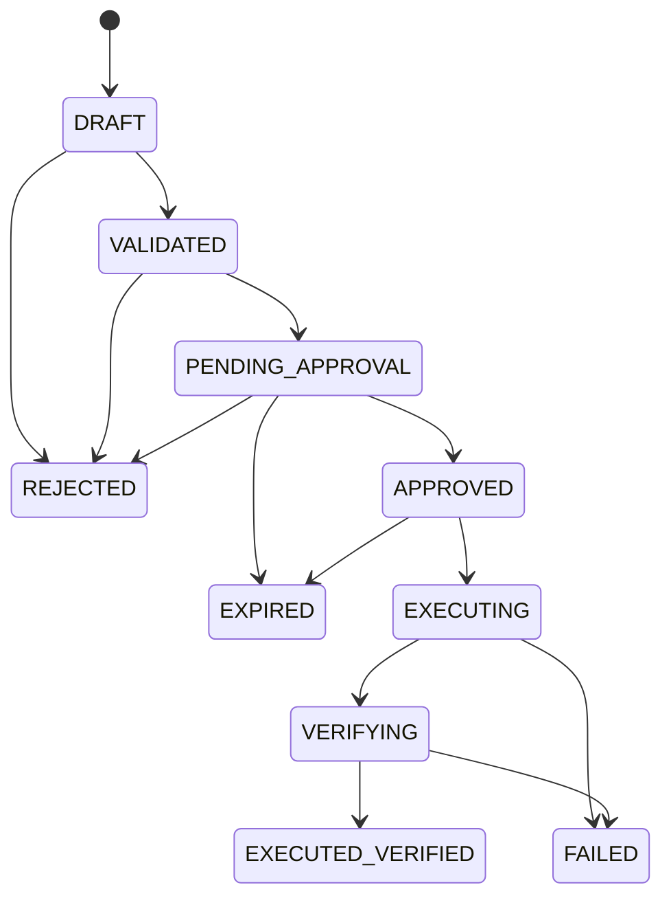

# Motor de Automações Supervisionadas — Konnexy Ads

## 1. Os 7 Motores Independentes (`src/automation/engines/automation-engine.ts`)

1. **`RuleEngine`**:
   - Verifica imediatamente se a regra está ativa (`rule.isEnabled`); regras desativadas nunca são avaliadas.
   - Resolve métricas dinamicamente para a janela temporal configurada (`rule.timeWindowDays`, ex.: 3, 7, 14 ou 30 dias).
   - Valida volume estatístico mínimo (`minImpressions`, `minClicks`, `minSpendBrl`) e período de `cooldownMinutes`.
2. **`PolicyEngine`**:
   - Valida parâmetros financeiros finitos (`Number.isFinite`), impede reduções inválidas (`<= -100%`), enforces o teto percentual da organização (`maxBudgetChangePct`) e bloqueia categorias de produtos restritos.
3. **`RiskEngine`**:
   - Classifica cada ação em `LOW`, `MEDIUM`, `HIGH` ou `CRITICAL`.
4. **`SimulationEngine`**:
   - Executa `provider.simulateMutation(request)` validando o isolamento do tenant antes de qualquer aprovação.
5. **`ApprovalEngine`**:
   - Valida um objeto `ApprovalRecord` estruturado (correspondência de `organizationId`, `campaignId`, `actionType`, status `APPROVED`, papel RBAC do aprovador com permissão `automation:approve_execution` e data de validade `expiresAt > now`).
6. **`ExecutionEngine` (`SupervisedExecutionEngine`)**:
   - Bloqueia imediatamente provedores não simulados na Foundation 1.1 (`!provider.isSimulated`).
   - Verifica o **Kill Switch Global** e o **Kill Switch por Organização** (`KillSwitchStore`).
   - Bloqueia execuções em modo **`READ_ONLY`**.
   - Garante idempotência concorrente (`IdempotencyStore.tryAcquireLock` com estados `IN_FLIGHT` e `COMPLETED`).
   - Executa **verificação independente pós-execução** (`provider.verifyMutation`) antes de confirmar a transição para `EXECUTED_VERIFIED`.
   - Controla falhas consecutivas por organização e provedor via `CircuitBreakerStore`.
7. **`AuditEngine`**:
   - Registra entradas estruturadas através da porta injetável `AuditLogStore`.

---

## 2. Máquina de Estados Explícita (`RecommendationStateMachine`)

